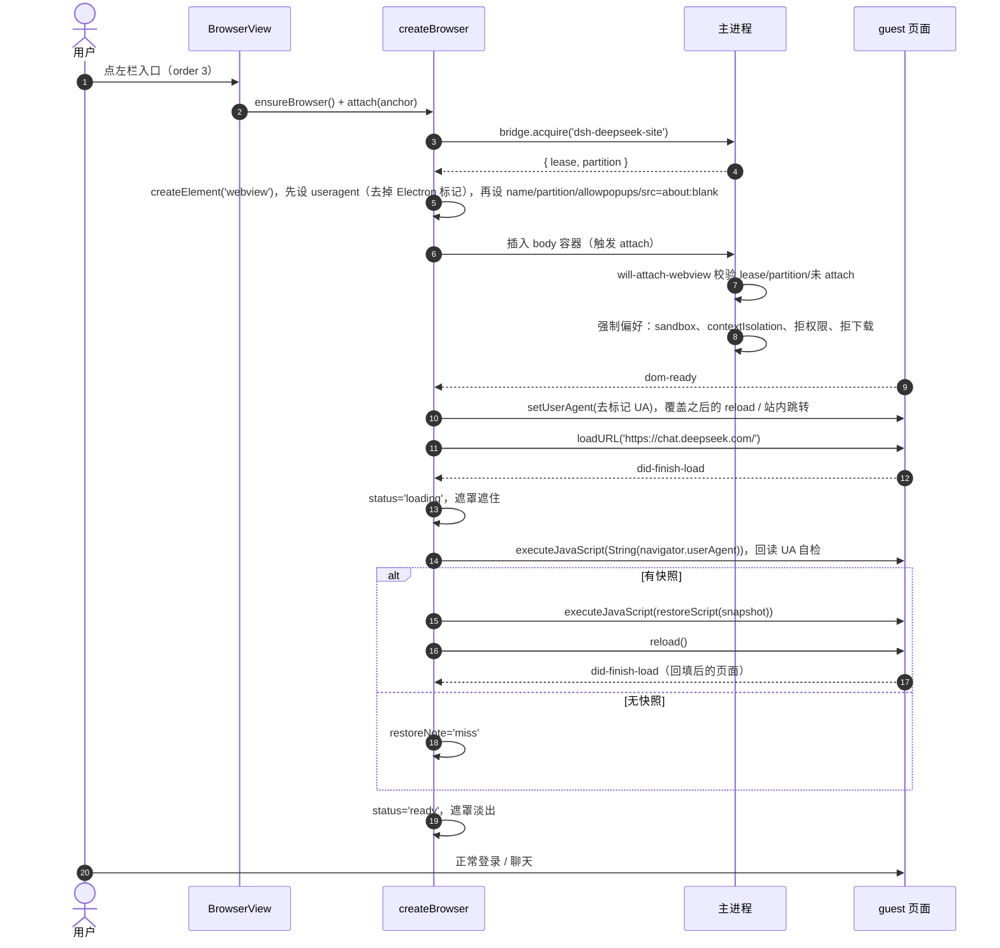
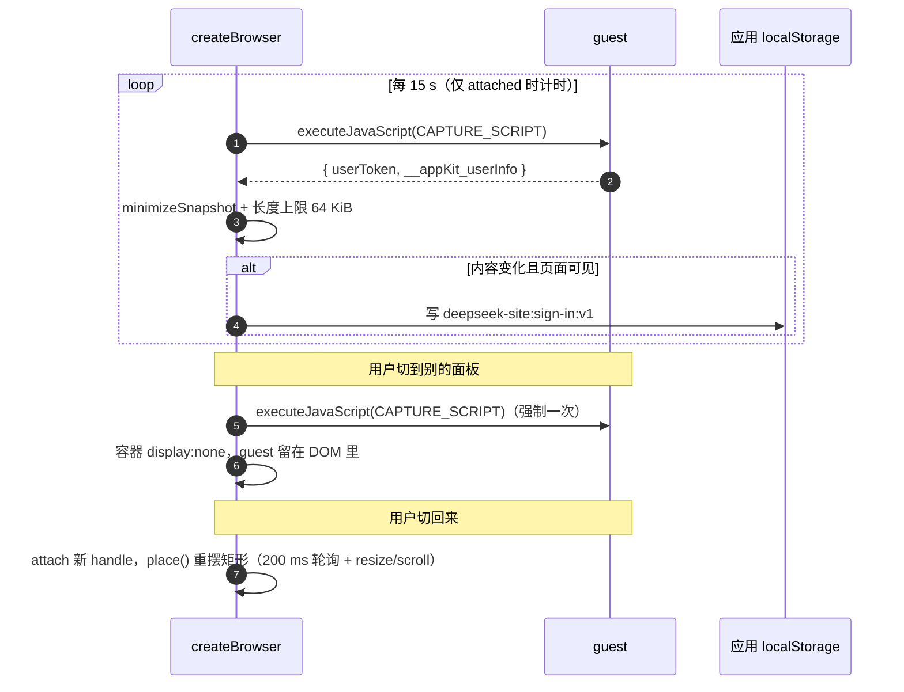
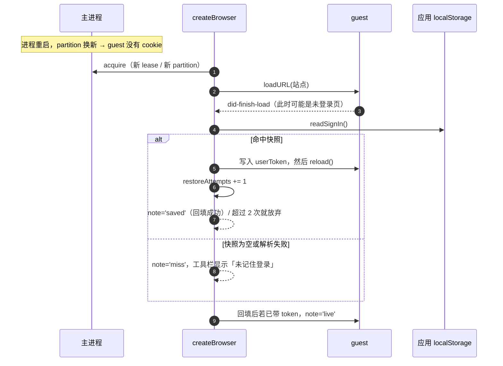
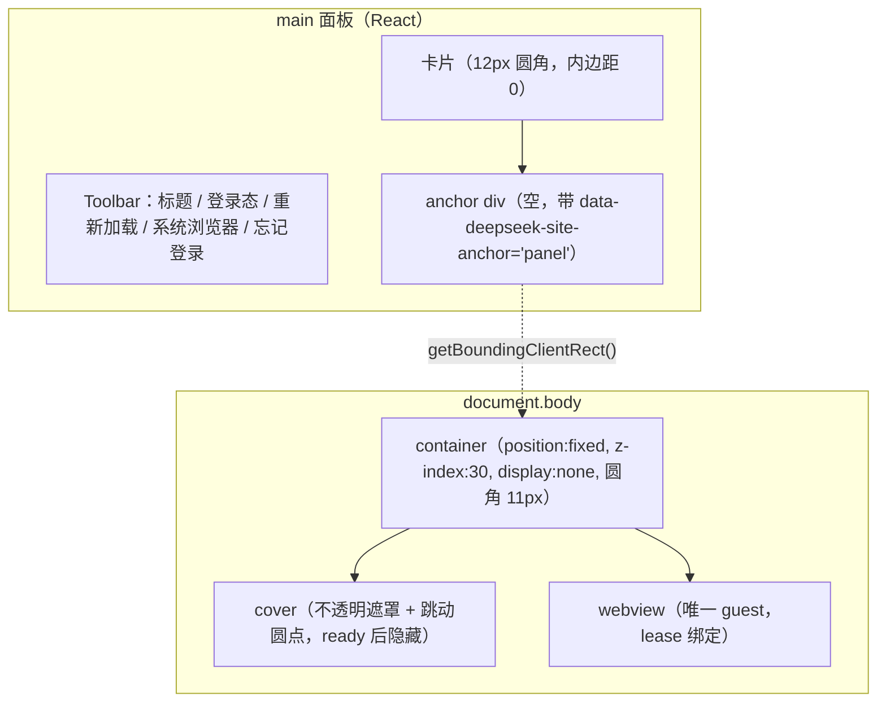
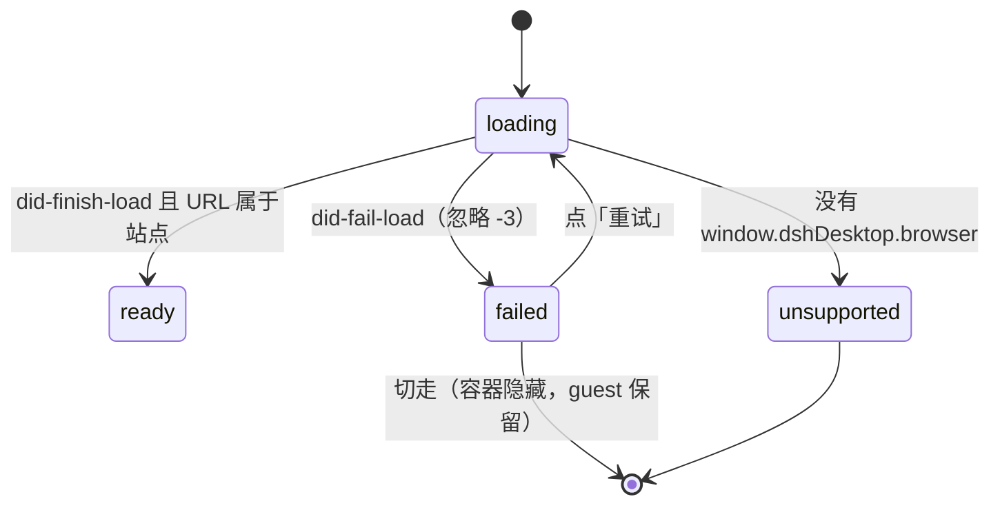

# 架构与运行时时序

> 只讲「点一下入口之后发生了什么」。术语、常量、文件位置见 [../AGENTS.md](../AGENTS.md)；发布流程见 [../publish/RELEASE.md](../publish/RELEASE.md)。

## 1. 参与者

| 参与者 | 位置 | 职责 |
| --- | --- | --- |
| `BrowserView` | React，注册在 `main` 槽 | 画工具栏和卡片，提供一个**空 `div` 作为 anchor**，不直接持有 guest |
| `createBrowser(bridge)` | 模块级单例，`client.js:552` | 管理固定定位容器、唯一的 `<webview>`、状态与订阅、快照抓取 |
| 主进程 `DesktopBrowserGuests` | `app.asar` 的 `lib/main.js` | 发 lease、校验 `will-attach-webview`、强制 webview 偏好、统一拒权限/下载 |
| guest 页面 | `<webview>` 里的 `chat.deepseek.com` | 真正的站点，自己管登录态 |
| 应用 `localStorage` | `dsh-app://app` 文档 | 存登录快照 `deepseek-site:sign-in:v1` 与诊断环 `deepseek-site:diag:v1` |

关键约束：**页面固定挂在 `document.body`，不跟着 React 树走**。React 只负责「把容器的矩形摆到哪里」，所以面板卸载不等于页面卸载。

## 2. 首次点开入口

## 3. 运行中：抓取与保活

`detach(handle)` 只在 `current === handle` 时才隐藏容器，所以「A 入口卸载」不会把「B 入口正在展示的页面」藏掉。

## 4. 重启后回填

## 5. 容器内部结构

`place()` 把 anchor 的 `left/top/width/height` 复制到容器上；anchor 断开或尺寸 < 8 px 时容器隐藏。

## 6. 状态机

`failed` / `unsupported` 时面板里显示 `FallbackCard`（重试 + 在系统浏览器打开），此时不 attach，避免对着一个死掉的 guest 反复摆位。

## 7. 不变量（改代码时别破坏）

1. **一个 bridge 一个 guest**：`acquire` 只在 `createBrowser` 里调一次，`release` 只在 `destroy()` 时调；重复 acquire 会拿到新 lease 而旧 guest 仍挂着，主进程会关掉不认识的那个。
2. **guest 属性四件套**：`name`、`partition`、`allowpopups`、`src=about:blank#<lease>`，少一个 `will-attach-webview` 就拒绝。
3. **快照只读两个 key**：`SNAPSHOT_KEYS = ['userToken', '__appKit_userInfo']`，不要把整个 `localStorage` 或 cookie 倒出来。
4. **快照只去应用源**：写 `dsh-app://app` 文档的 `localStorage`，不写文件、不发网络；跨重启靠的是应用源持久化，而不是 guest 的 partition。
5. **导航白名单**：只有 `chat.deepseek.com` 留在 guest 内；站外 https 一律 `window.open` 交给系统浏览器，2 s 内同址去重（`EXTERNAL_DEDUPE_MS`）。
6. **面板卸载 ≠ 销毁**：切面板只 `detach`；只有插件被卸载/禁用才 `destroy()`（同时清 interval、断开 `AbortController`、`element.remove()`）。
7. **遮罩只在未 ready 时遮**：回填会触发一次 `reload()`，遮罩是防登录页闪烁的唯一手段，别在 `loading` 阶段提前撤。
8. **UA 必须在首次导航前就位**：站点「使用环境异常」的判断是 UA 里有没有 `electron` 字样。`useragent` 属性在 `src` 之前写入才会被 `createGuest` 的首次 `loadURL` 采用；`setUserAgent()` 方法在 `dom-ready` 前调用必抛 `Invalid guestInstanceId`，只能用于之后的 reload / 站内跳转。
